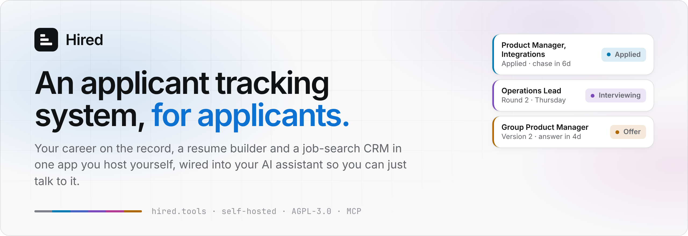
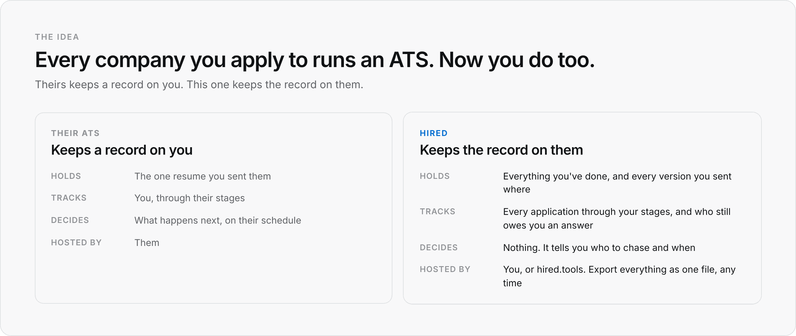
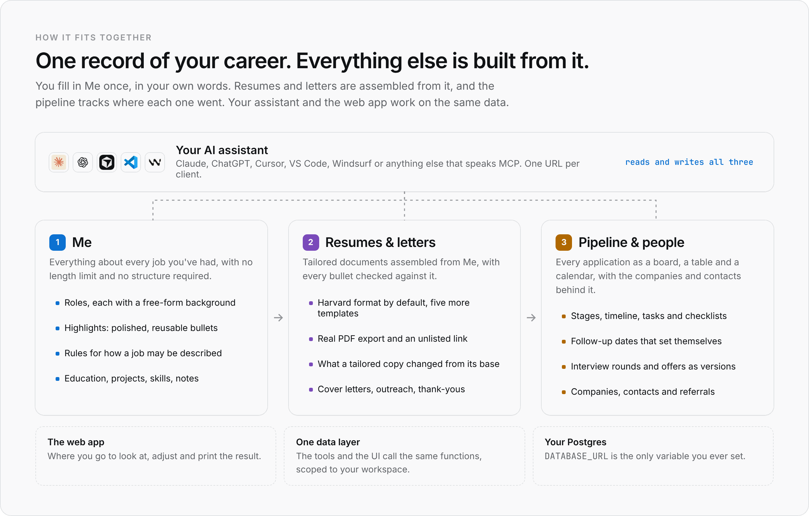
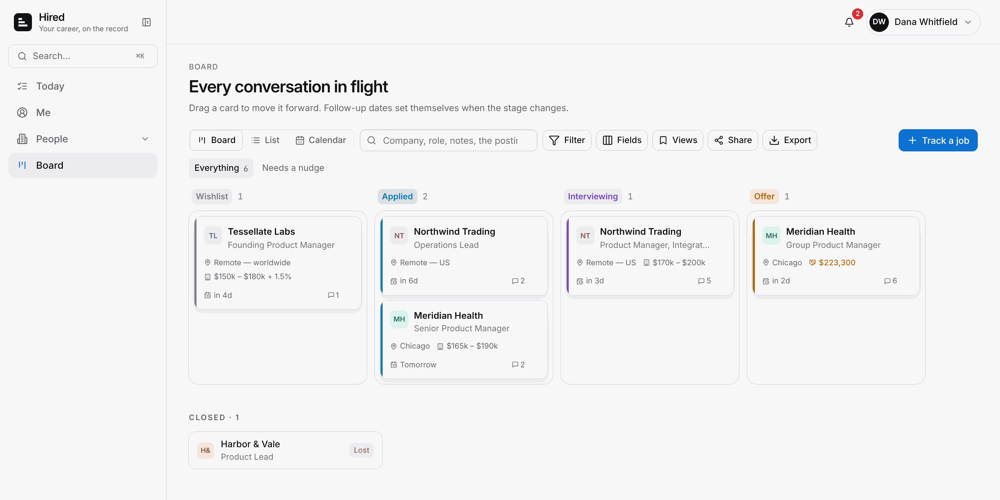
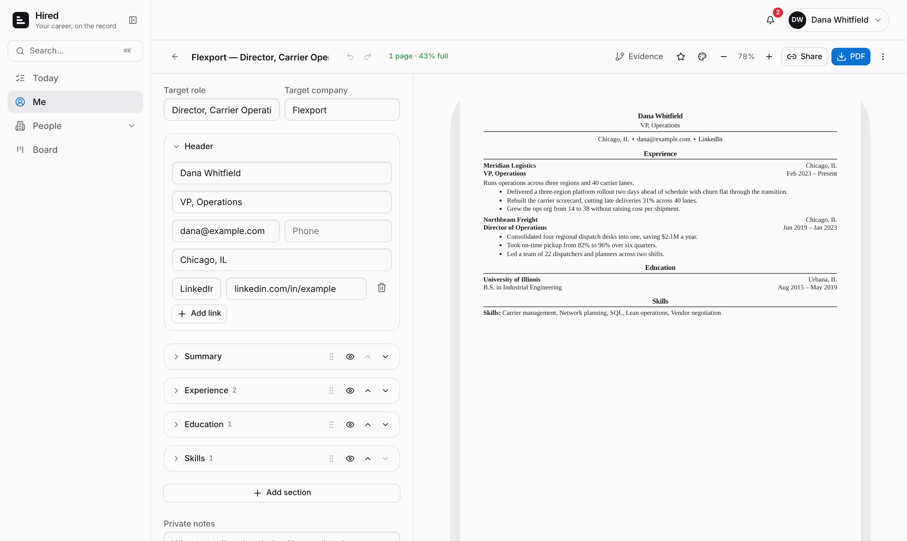
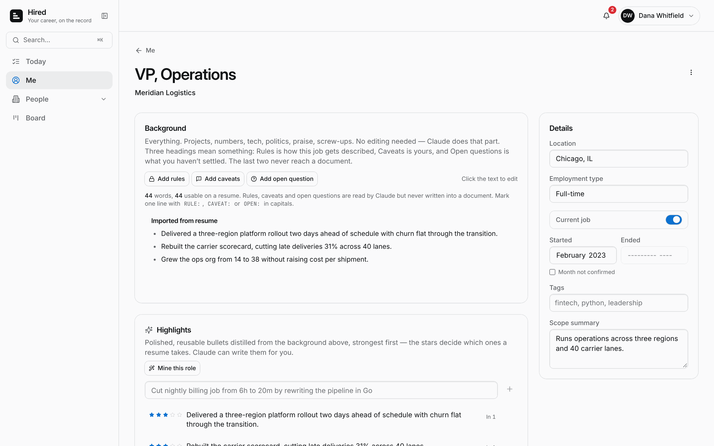
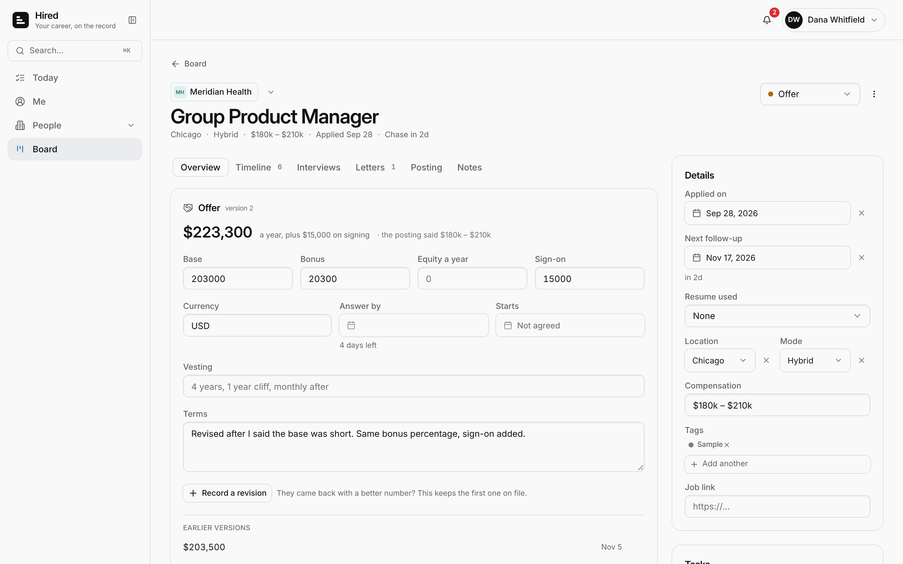
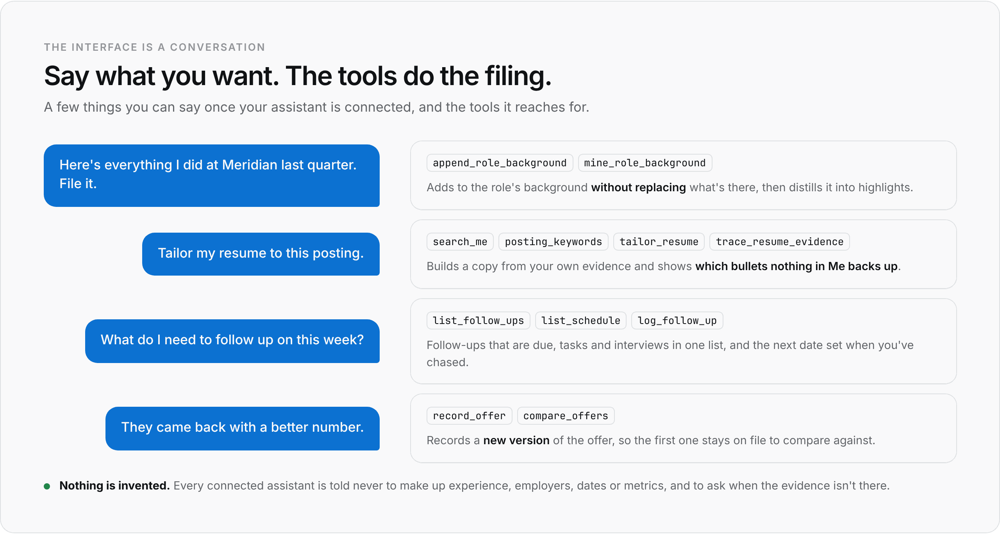

<h1 align="center">
<picture>
  <source media="(prefers-color-scheme: dark)" srcset=".github/readme/banner-dark.png">
  
</picture>
</h1>

<p align="center">
  <a href="https://hired.tools">hired.tools</a> ·
  <a href="https://docs.hired.tools">The manual</a> ·
  <a href="#get-it">Self-host it</a> ·
  <a href="#connect-your-ai">Connect your AI</a> ·
  <a href="https://docs.hired.tools/tools/overview">Every tool</a>
</p>

**An applicant tracking system, for applicants.**

Every company you apply to runs one. Theirs keeps a record on you, scores what you sent and
decides what happens next. This one keeps the record on them — a record of your career, a
resume builder and a job-search CRM in one app you host yourself, wired into your AI
assistant so you can just *talk* to it.

> "Here's everything I did at Vertex last quarter — file it."
> "Tailor my resume to this posting."
> "What do I need to follow up on this week?"

The manual is at **[docs.hired.tools](https://docs.hired.tools)**: getting connected, filling
in Me, tailoring a resume, running the search, every tool with its arguments, and the deploy
guides in full. This page is the front door.

<picture>
  <source media="(prefers-color-scheme: dark)" srcset=".github/readme/flip-dark.png">
  
</picture>

## What's in it

<picture>
  <source media="(prefers-color-scheme: dark)" srcset=".github/readme/how-dark.png">
  
</picture>

- **Me** — everything you know about every job you've had, with no length limit and no
  structure required. It's the raw material every document is built from, and it can carry
  your own rules about how a job may be described, which every assistant is told to obey.
- **Resumes** — tailored documents assembled from Me, Harvard OCS format by default, with
  five other templates, live preview, real PDF export and an unlisted link for forms that
  want a URL. Every tailored copy can show what it changed from its base, and which of its
  bullets nothing in Me backs up.
- **Letters** — cover letters, cold messages, referral asks, thank-yous and replies, drafted
  from the posting, your evidence and the letters you have already written yourself.
- **Pipeline** — a board, a table and a calendar of every application, with stages, a
  timeline, tasks, follow-up dates that set themselves, interview rounds, offers recorded as
  versions, and saved views you can share read-only.
- **People** — the companies and contacts behind the search as records in their own right,
  with timelines, referrals and pings.

Nothing on a resume is invented. Every connected assistant is told never to make up
experience, employers, dates or metrics, and to say so and ask when the evidence isn't there.

## See it

The screens below are the app itself, light and dark, filled with the sample workspace and an invented candidate.

<table>
  <tr>
    <td width="50%">

<picture>
  <source media="(prefers-color-scheme: dark)" srcset=".github/readme/screen-board-dark.png">
  
</picture>
<p align="center"><sub><b>Pipeline</b>: every application, with follow-up dates that set themselves</sub></p>

    </td>
    <td width="50%">

<picture>
  <source media="(prefers-color-scheme: dark)" srcset=".github/readme/screen-resume-dark.png">
  
</picture>
<p align="center"><sub><b>Resumes</b>: built from Me, with a live preview and real PDF export</sub></p>

    </td>
  </tr>
  <tr>
    <td width="50%">

<picture>
  <source media="(prefers-color-scheme: dark)" srcset=".github/readme/screen-role-dark.png">
  
</picture>
<p align="center"><sub><b>Me</b>: a role's raw background and the highlights drawn from it</sub></p>

    </td>
    <td width="50%">

<picture>
  <source media="(prefers-color-scheme: dark)" srcset=".github/readme/screen-offer-dark.png">
  
</picture>
<p align="center"><sub><b>Offers</b>: recorded as versions, so the first number stays on file</sub></p>

    </td>
  </tr>
</table>

## Get it

**Hosted** — [hired.tools](https://hired.tools). I run an instance at app.hired.tools and
host people on it for a monthly fee. Your workspace is private: instance admins manage
accounts, never content.

**Self-host** — free, AGPL, yours. `DATABASE_URL` is the only variable you ever set;
everything else is configured inside the app.

With Docker:

```bash
curl -fsSLO https://raw.githubusercontent.com/shifulaboratories/Hired/main/docker-compose.yml
docker compose up -d
docker compose logs app   # your sign-in details are printed here, once
```

That pulls the published image, starts the app and a Postgres beside it, applies migrations
and creates your owner account. Sign in at http://localhost:3000 with the password from the
log; the first screen asks for your own email and a new password. PDF export works out of
the box, because the image carries the browser and fonts the renderer needs. Upgrade with
`docker compose pull && docker compose up -d`.

With Railway, no terminal: deploy this repository, add a Postgres, set `DATABASE_URL` to
`${{Postgres.DATABASE_URL}}`, generate a domain and read the password from the deploy log.
[The five steps in full →](https://docs.hired.tools/self-hosting/railway)

Locked out? Set `RESET_OWNER_PASSWORD=1`, redeploy, read the new password from the log, and
remove the variable.

The digest emails and the background sweeps run when a scheduler you set up calls them; the
app keeps no timers. [Scheduling →](https://docs.hired.tools/self-hosting/scheduling)

## Connect your AI

Open **Settings** in the app. It opens on **Connections**, and there is already one waiting:
pick the assistant you use — Claude, Claude Code, ChatGPT, Cursor, VS Code, Windsurf or
anything else that speaks MCP — and the steps appear with your URL filled in. Each client
gets its own URL, so one can be cut off without breaking the rest. Treat them like passwords.

Once it's connected, your assistant has 194 tools, 227 if you're an admin. A hundred and
eighty-seven of them read and write your material; the other seven are workflows — tailor a
resume, write a letter, mine a background into highlights, review the pipeline, research a
company, log your week, and bring the pipeline up to date from your inbox — each a plan the
assistant follows using the tools. Admins get 32 more data tools and an eighth workflow for
inviting someone. Members never see the admin tools at all.
[Every tool, written out →](https://docs.hired.tools/tools/overview)

<picture>
  <source media="(prefers-color-scheme: dark)" srcset=".github/readme/talk-dark.png">
  
</picture>

There is also a chat built into the app for anyone who hasn't connected an assistant yet, if
an admin gives it an Anthropic API key.

## Your data

One person per workspace, many people per instance, and no code path from one workspace to
another: every data function takes the owner's id as its first argument and every query
filters on it. **Settings → Account → Download everything** saves your whole workspace as one
JSON file, and handing it back restores it, additively. Deleting a company, a person or an
application puts it in an archive for thirty days rather than destroying it.
[Security and privacy →](https://docs.hired.tools/reference/security) ·
[Taking your data with you →](https://docs.hired.tools/reference/your-data)

## Running it locally

You need Node 20 or later (22.18 or later to run `npm run check`) and a Postgres database.

```bash
cp .env.example .env      # only DATABASE_URL is required
npm install
npx prisma migrate deploy
npm run dev
```

Open http://localhost:3000. Your owner password is printed in the terminal on first start.
`npm run dev` applies no migrations; `npm start` does.

## Contributing

Issues and pull requests are welcome. Read [CLAUDE.md](CLAUDE.md) first, whichever agent or
editor you use — it is the working agreement, and `AGENTS.md` points at the same file. The
gate before anything lands:

```bash
npm run typecheck   # tsc, no emit
npm run check       # the pure rules, no database
npm run probe       # the data layer against a database whose name contains "probe"
npm run build       # what the deploy runs
node tools/gen-tool-docs.mjs --check   # the generated tool pages are current
```

Two things are worth knowing before changing anything. Tenant isolation is a compile-time
property: a data function without the owner's id as its first argument does not belong in
`src/lib/data/`. And the MCP tools and the UI share that one data layer, so a rule is written
once and both use it.

## How it's built

Next.js 15 · React 19 · Tailwind v4 · shadcn/ui · Prisma · PostgreSQL.

The MCP server in `src/lib/mcp/` speaks Streamable HTTP directly and holds no session state,
so it survives restarts and replicas. Tools are defined once in `src/lib/mcp/tools.ts`. The
connection token lives in the URL path because that is the one shape every client can
express; `/api/mcp` also takes `Authorization: Bearer <token>`.

The pictures in this README are drawn in `.github/readme/art.html` and rendered with
`node .github/readme/render.cjs`. Change the words there, not the PNGs.

## License

AGPL-3.0 — see [LICENSE](LICENSE). Self-host it, modify it, run it for yourself and your
friends. If you run a modified copy as a service for other people, publish your changes.
